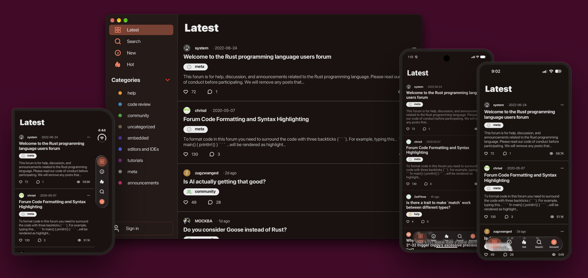

# RustForum

A native client for the [Rust Users Forum](https://users.rust-lang.org), built with Rust and the [Aimer](https://aimer.rs) UI framework.



## Features

- Browse the **Latest**, **New** and **Hot** topic feeds, or filter by category
- Read posts and their comments, with code blocks highlighted
- View user profiles
- Search topics
- Sign in with an email code or a password
- Choose a light or dark theme

## Getting started

**Requirements:** Rust (edition 2024) and [Aimer](https://github.com/aimer-rs/aimer). `Cargo.toml` points Aimer at `../aimer` by default. To use the Git version instead, swap in the commented-out `git` dependency.

### Aimer CLI (recommended)

```bash
curl -fsSL https://aimer.rs/install.sh | sh
aimer run
```

### Cargo

```bash
cargo run  # assets may not load properly
```

## Project layout

| Path             | Purpose                             |
| ---------------- | ----------------------------------- |
| `src/api`        | Forum HTTP client                   |
| `src/screen`     | App screens                         |
| `src/components` | Reusable UI widgets                 |
| `src/models`     | Data types                          |
| `assets/`        | Icons and images                    |
| `aimer.toml`     | Aimer app config and asset manifest |
